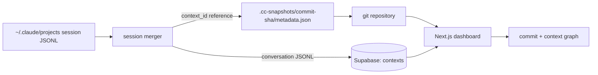

# Continuum

**Version control for your AI pair-programming context: Claude Code conversations captured at every git commit, restorable when you check out old code.**


<!-- DEMO GIF: record the dashboard graph view (blue commit timeline + orange Claude context nodes) and embed it here -->

> **Core idea:** git handles branching; Continuum handles the conversation that happened between commit A and commit B.

## What It Does

- Links the Claude Code sessions that produced each commit to that commit's SHA.
- Merges multiple sessions between two commits into one thread, with clear session boundaries.
- Visualizes commits and Claude contexts together as an interactive SVG graph in a project dashboard.
- Designed so you can check out an old commit and pick up the conversation that led to it.

**Status:** the dashboard, graph and data model are built. Automatic capture through a git pre-commit hook is the next step (see [TECHNICAL_OVERVIEW.md](TECHNICAL_OVERVIEW.md)).

## Architecture



Conversation bodies live in Supabase so repositories stay light; only small metadata references are committed under `.cc-snapshots/`. Local state lives in a gitignored `.cc-context/`. See [TECHNICAL_OVERVIEW.md](TECHNICAL_OVERVIEW.md) and [tech_design.md](tech_design.md) for the full design, including session-merging rules and graph layout.

## Tech Stack

- Next.js 16 (App Router, React Server Components) and React 19 with the React Compiler
- TypeScript (strict), Tailwind CSS 4, Radix UI, React Hook Form + Zod
- Supabase (Postgres, auth, row-level security)

## Run Locally

Prerequisites: Node.js 20+ and a Supabase project.

```bash
npm install
cp .env.example .env.local   # fill in the values below
npm run dev
```

| Variable | Purpose |
| --- | --- |
| `NEXT_PUBLIC_SUPABASE_URL`, `NEXT_PUBLIC_SUPABASE_ANON_KEY` | Supabase client |
| `SUPABASE_SERVICE_ROLE_KEY` | Server-side database access |
| `GITHUB_TOKEN` | Reading repository commit history |
| `ANTHROPIC_API_KEY` | Claude features |

Apply the schema in [schema.md](schema.md) to your Supabase project, then open [http://localhost:3000](http://localhost:3000).

## Project Layout

```text
app/          routes: auth, dashboard, projects API
components/   git-graph (SVG nodes and connections), chat, projects
lib/          Supabase clients, graph layout, types, design tokens
docs/         chat-history parser plan
```

## Team

Built by [Owen Fisher](https://github.com/obro79), Aaryan Rampal and Derek Chu.
